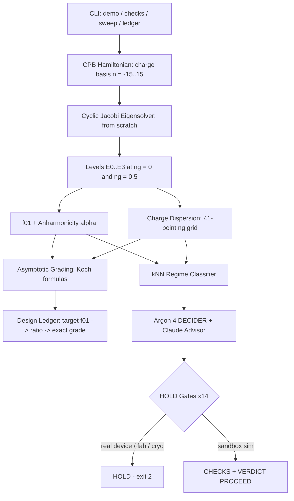
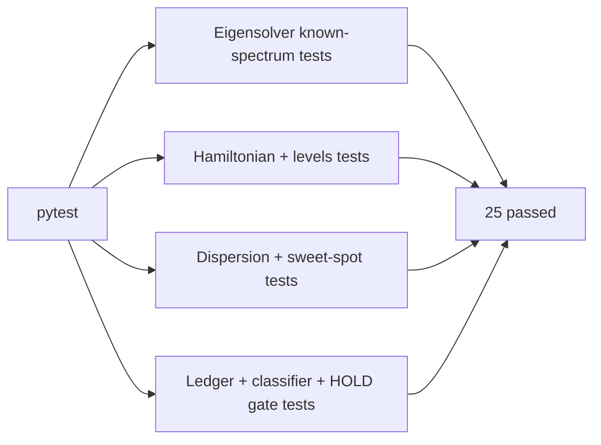
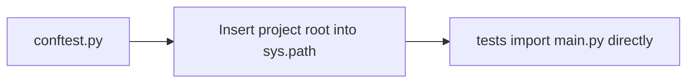
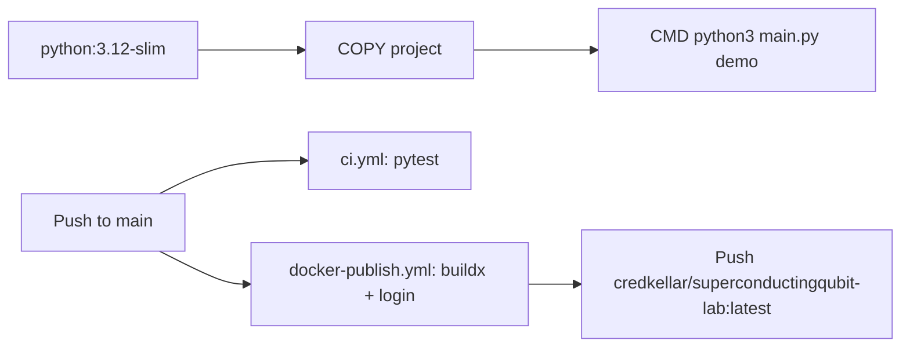

# SuperconductingQubit-Lab ⚛️🔌

**Transmon / Cooper-Pair Box Lab** — by Darion Kellar

SuperconductingQubit-Lab is an **educational superconducting-qubit lab** in ONE pure-Python file. It builds the **Cooper-pair box** Hamiltonian in the charge basis — `H = 4 E_C (n − ng)² − (E_J/2)(|n⟩⟨n+1| + h.c.)` over n = −15..15 — diagonalises it with a **from-scratch cyclic Jacobi eigensolver** (no library diagonalisation anywhere), and then sweeps the one knob that defines the field, **E_J/E_C ∈ {1, 5, 10, 20, 50, 100}**, watching a single device morph from a **charge qubit** into a **transmon**:

- At **E_J/E_C = 1** the lab shows the charge qubit honestly: level 1's charge dispersion (ε₁ = **2.512 E_C**) is **2.52× larger than the qubit frequency itself**, and the anharmonicity is a huge **+6.55 E_C** — these are charge states, not a qubit ladder.
- At **E_J/E_C = 100** the same code prints the transmon: ε₁ collapses to **2.488e-08 E_C** (9.13e-10 of f01), the anharmonicity settles to **−1.095 E_C ≈ −E_C** (4.0% of f01), and f01 matches the textbook asymptotic formula to **0.14%**.

Every level is graded against the Koch et al. asymptotic formulas, the dispersion is graded against its own exponential asymptotic form, the sweet spot is verified numerically (`df01/dng ≈ −3.9e-12` at ng = 0.5), and a design ledger inverts the formula for target frequencies and lets the diagonalisation mark the homework. 🔬

Honest scope, stated up front: every parameter is a **labelled teaching number** — energies are in units of E_C, and the GHz conversion uses a labelled E_C/h = 0.250 GHz in the typical transmon range. Nothing here is any real device's specification, and this lab operates **nothing real**: no qubits, no junctions, no cryogenics. Every device / fabrication / vendor / advantage use sits behind a permanent HOLD gate (14 total). 🔒

[](https://github.com/kimanicollier44-cmyk/SuperconductingQubit-Lab/actions/workflows/ci.yml)
[](https://github.com/kimanicollier44-cmyk/SuperconductingQubit-Lab/actions/workflows/docker-publish.yml)

> ℹ️ These are the **live** workflow badges for this repo. They activate as soon as the `ci.yml` and `docker-publish.yml` files from the paste pack are pasted into `.github/workflows/` — until then they have nothing to report yet.

## 🧰 Tech Stack Badges & Full Architecture Tech Stack

### 💻 Core Programming Languages & Core Systems


- 🐍 Python 3.12, pure standard library (`math`, `hashlib`, `json`, `sys`) — zero dependencies, zero network, deterministic (double-run byte-identical)
- 🔢 Eigensolver from scratch: a cyclic Jacobi solver for real symmetric matrices — Givens rotations sweep the off-diagonal mass to machine noise; its spectrum is graded in CHECKS against the identity, a known 2×2, the tridiagonal Toeplitz spectrum `2cos(kπ/5)`, and a full `V·diag·Vᵀ` reconstruction before any physics is trusted
- ⚛️ Qubit core: the Cooper-pair box Hamiltonian built entry by entry — charging parabola `4 E_C (n − ng)²` on the diagonal, Josephson tunnelling `−E_J/2` on the off-diagonals — with levels E0..E3, f01, anharmonicity α, charge dispersion ε₁ over a 41-point ng grid, the asymptotic Koch formulas, and a design ledger that inverts them
- 🧠 TinyML kNN regime classifier (from scratch, stdlib, distance-weighted): charge-qubit / crossover / transmon / deep-transmon from (E_J/E_C, ε₁/f01, α/f01), labels from the lab's own regime policy
- 🪑 Council seats: Gemini Argon 4 DECIDER (names-only, tighten-only) + Muse advisor (never overrides HOLD) + Google Flow plan-only (rendered = False, live = 0)

### ⛓️ Web3 & Infrastructure

- 🚫 **Not applicable — honestly.** No blockchain, no Web3, no tokens: the "infrastructure" in this lab is a labelled Hamiltonian, a 31-state charge basis, and an eigensolver inside one offline file. No fake badges here.

### ⚙️ Platform Support & Hardware Architecture


- 🖥️ Pure Python — runs anywhere Python 3.12+ runs (Linux, macOS, Windows), plus the `python:3.12-slim` Docker image
- 🔒 No hardware is controlled, ever: real qubits, Josephson junctions, dilution refrigerators, and control electronics are permanent HOLD gates (see the gate table below)

### ⚡ Low-Level Infrastructure & Performance

- 🚫 **No low-level code — honestly.** No C, no C++, no GPU, no compiled extensions: this is one interpreted Python file on purpose, so every matrix entry can be read, checked, and diffed. Performance here means honest algorithms — a cyclic Jacobi eigensolver, a 41-point dispersion grid, and bisection-free closed-form ledger inversion — all deterministic and byte-identical between runs.

### 🛠️ DevOps & Build Tools


- 🐳 Docker (`python:3.12-slim`), GitHub Actions CI + Docker Publish (delivered in the paste pack)
- 🎯 Target image: `credkellar/superconductingqubit-lab:latest`
- 🧪 Tests: `pytest` (25 tests) + the built-in CHECKS suite (47 checks) in `main.py`

### ☁️ Cloud Providers

- 🚫 **None — honestly.** No cloud provider is used or needed: the lab runs fully offline on your own machine or in a local Docker container. Docker Hub appears only as the registry the publish workflow pushes the image to.

## What this does?

1. 🏗️ **Builds the Hamiltonian** — the Cooper-pair box in the charge basis: diagonal `4 E_C (n − ng)²` (a Cooper pair costs charging energy), off-diagonal `−E_J/2` (a pair tunnels through the junction), 31 charge states n = −15..15, E_C = 1 as the energy unit. The matrix is asserted symmetric with the exact trace formula in CHECKS before it is diagonalised.
2. 🔢 **Diagonalises it from scratch** — a cyclic Jacobi eigensolver (Givens rotations, fixed sweep order, deterministic) graded against known spectra: identity, [[2,1],[1,2]] → (1, 3), the Toeplitz spectrum 2cos(kπ/5), plus eigenvector orthonormality and full reconstruction `V·diag·Vᵀ = A` to 1e-9.
3. 📊 **Prints the levels at both charge points** — E0..E3 at ng = 0 and at the sweet spot ng = 0.5 for every ratio, with spacings graded against the asymptotic formula: at E_J/E_C = 50, E1−E0 = **18.94188** vs 19.00000 asymptotic, E2−E0 = 36.73584 vs 37.00000, E3−E0 = 53.22086 vs 54.00000.
4. 🎚️ **Sweeps E_J/E_C = 1 → 100** — one table, six regimes: f01 climbs 0.99611 → 27.24514 E_C while the asymptotic formula's relative error falls **0.455 → 0.00143**, monotonically — the expansion becoming true in front of you.
5. 🌊 **Measures charge dispersion** — ε₁ = max − min of E1(ng) over a full period: **2.512 E_C** at ratio 1, 0.9965 at 5, 0.2413 at 10, 1.698e-02 at 20, 3.907e-05 at 50, **2.488e-08** at 100 — a fall of eight orders of magnitude, with the log-slope per unit √(8 E_J/E_C) rising toward 1, the `exp(−√(8 E_J/E_C))` law made visible.
6. ⚖️ **Grades the dispersion against its own asymptotic form** — the Koch leading-order ε₁ formula (with its 2⁹·√(2/π)·(E_J/2E_C)^(5/4) prefactor) is approached from below: exact/asymptotic = **0.830** at ratio 50 and **0.880** at ratio 100, converging as it should.
7. 🎵 **Tells the anharmonicity story honestly** — α = (E2−E1) − (E1−E0) starts at **+6.55084 E_C** in the charge regime (positive! the levels are charge states), crosses zero near ratio 10 (−0.27013), overshoots slightly (−1.15220 at 20), and settles toward the asymptotic **−E_C** exactly: |α + E_C| shrinks monotonically 0.730 → 0.152 → 0.148 → 0.0955 across ratios 10 → 100. In the transmon regime α/f01 is −6.1% at 50 and −4.0% at 100 — enough to address the qubit, small enough to leak, printed as both.
8. 🎯 **Verifies the sweet spot numerically** — the central difference df01/dng at ng = 0.5 is **−3.91e-12** at ratio 50 and −3.33e-14 at ratio 1: first-order charge-noise immunity holds at every ratio; what the transmon adds is a dispersion so tiny the second-order wobble stops mattering.
9. 🧮 **Runs a design ledger** — pick a target f01, invert the asymptotic `f01 = √(8 E_J E_C) − E_C` at the labelled E_C/h = 0.250 GHz, then let the full diagonalisation grade the answer: target 5.0 GHz → ratio **55.125** → exact **4.9863 GHz (−0.27%)**, α exact −0.2847 GHz vs −0.250 predicted; targets 4 and 6 GHz land within −0.44% and −0.19%.
10. 🏷️ **Classifies the regime + seats + checks** — a from-scratch distance-weighted kNN labels each sweep point charge-qubit / crossover / transmon / deep-transmon from (E_J/E_C, ε₁/f01, α/f01) and is asserted equal to the lab's own policy on every scenario and all 1,056 training-grid rows, with Argon 4 DECIDER (sha256 trace), Muse advisor, Google Flow plan-only, and a built-in CHECKS suite (47 checks).

## 🗺️ How it works — diagram per script

### `main.py` — the whole lab



### `tests/test_main.py` — verification



### `conftest.py` — test path setup



### `Dockerfile` + CI flow — container & publish



## Why is this cool?

1. 🌊 The transmon's entire selling point is **one collapsing number**: ε₁/f01 falls from 2.52 (the "qubit" frequency is mostly charge noise) to 9.13e-10 across one sweep table — eight orders of magnitude, computed, not quoted.
2. 🔢 The eigensolver is **graded before it is trusted**: known spectra, orthonormality, and a full matrix reconstruction stand in CHECKS ahead of every physics claim.
3. 📉 The asymptotic formulas are treated as **hypotheses, not answers**: f01's relative error falls monotonically 0.455 → 0.00143 as E_J/E_C grows, so you watch perturbation theory switch on.
4. 🎵 Anharmonicity **changes sign** in the sweep — +6.55 E_C of charge-state spacing becomes −E_C of weakly-anharmonic ladder — and the lab prints the overshoot (−1.152 at ratio 20) instead of hiding it.
5. ⚖️ Even the dispersion gets graded: the exact ε₁ chases its own exponential asymptotic form (0.830 → 0.880 of it, converging), a check almost no explainer runs.
6. 🎯 The sweet spot is **verified, not asserted**: a numerical derivative of −3.9e-12 at ng = 0.5, at both ends of the sweep.
7. 🧮 The design ledger closes the loop engineers actually use: target frequency in, ratio out, exact diagonalisation grading the formula's answer to −0.27% at 5 GHz.
8. 🏷️ The classifier's labels come from the lab's **own policy** and are asserted equal to it on all 1,056 grid rows — the kNN interpolates the physics story, it doesn't invent one.
9. 🧒 The charge-qubit regime is shown **honestly**: at E_J/E_C = 1 the dispersion exceeds f01 itself, which is exactly why nobody builds qubits there anymore — the numbers say it, not the prose.
10. 🎯 Deterministic end to end: run it twice, get byte-identical output — a transmon you can diff.

## What problems this solves?

1. ❌ **Problem:** "Transmons are insensitive to charge noise" is usually a slogan. ✅ **Solution:** ε₁ is computed on a 41-point ng grid at six ratios; the exponential collapse *is* the explanation, with the log-slope printed.
2. ❌ **Problem:** Textbook formulas get quoted outside their regime. ✅ **Solution:** The asymptotic f01 is wrong by 45.5% at E_J/E_C = 1 and 0.14% at 100 — the sweep shows exactly where the formula earns trust.
3. ❌ **Problem:** Anharmonicity is quoted as "−E_C" as if it were exact. ✅ **Solution:** The exact α is printed at every ratio — sign change, overshoot, and slow settle toward −E_C included.
4. ❌ **Problem:** The charge-qubit regime is skipped in most intros, so the transmon looks like magic. ✅ **Solution:** Ratio 1 is measured with the same code path: dispersion 2.52× f01, α = +6.55 E_C — the problem the transmon solves, in numbers.
5. ❌ **Problem:** "Sweet spot" gets asserted from symmetry arguments alone. ✅ **Solution:** df01/dng is computed by central difference at ng = 0.5 and lands at 1e-12, at both ends of the sweep.
6. ❌ **Problem:** Dispersion asymptotics are rarely checked against exact diagonalisation. ✅ **Solution:** Exact/asymptotic ε₁ ratios (0.830, 0.880, converging to 1) are first-class CHECKS.
7. ❌ **Problem:** Design rules ("aim for E_J/E_C ≈ 50") float free of any derivation. ✅ **Solution:** The ledger inverts the formula for 4/5/6 GHz targets and grades each ratio exactly, dispersion included.
8. ❌ **Problem:** Black-box eigensolvers hide whether the spectrum is even right. ✅ **Solution:** Jacobi is implemented in the open and graded against three known spectra plus a reconstruction identity.
9. ❌ **Problem:** Teaching numbers quietly become "device specs" downstream. ✅ **Solution:** E_C/h is labelled a teaching conversion everywhere it appears, and `vendor_spec_claim` / `teaching_number_as_measurement` are permanent HOLD gates.
10. ❌ **Problem:** Simulation tools quietly imply hardware is next. ✅ **Solution:** 14 named HOLD gates return exit code 2 for every device-control, fabrication, cryogenics, or advantage claim, forever.

## How to install this?

1. 📋 Clone or download this project folder.
2. 🐍 Make sure Python 3.12+ is installed: `python3 --version`
3. ▶️ Run the full demo + checks (no arguments needed):

```bash
python3 main.py
```

4. 🧪 Run the test suite:

```bash
pip install pytest
python3 -m pytest -q
```

5. 🎛️ Try the other commands:

```bash
python3 main.py checks          # 47 built-in checks
python3 main.py levels          # E0..E3 at ng = 0 and ng = 0.5, all ratios (JSON)
python3 main.py dispersion      # charge dispersion + asymptotic grading (JSON)
python3 main.py anharmonicity   # f01, alpha, alpha/f01 per ratio (JSON)
python3 main.py sweep           # the full E_J/E_C sweep table (JSON)
python3 main.py ledger          # target f01 -> formula ratio -> exact grade (JSON)
python3 main.py classify        # kNN regime classifier report
python3 main.py brains          # Argon 4 + Muse + Flow seats
python3 main.py holds           # list all 14 HOLD gates
python3 main.py hold-demo       # exits 2 - gated actions stay HOLD
```

6. 🐳 Or run it in Docker:

```bash
docker build -t credkellar/superconductingqubit-lab:latest .
docker run --rm credkellar/superconductingqubit-lab:latest
```

## Requirements

- 🐍 Python 3.12 or newer
- 📦 Dependencies: **none** (standard library only)
- 🌐 Network: **none** — fully offline
- 🧪 For tests only: `pytest`
- 🐳 Optional: Docker

## FULL project structure tree

```text
superconductingqubit-lab/
├── main.py                  # the whole lab: CPB Hamiltonian, Jacobi eigensolver, sweep, dispersion, anharmonicity, ledger, classifier, seats, HOLD gates
├── conftest.py              # puts the project root on sys.path for tests
├── tests/
│   └── test_main.py         # 25 pytest tests: eigensolver, Hamiltonian, asymptotics, dispersion, sweet spot, ledger, gates, determinism
├── assets/
│   └── cover.png            # README cover image (2736 x 912)
├── Dockerfile               # python:3.12-slim, runs the demo
├── .gitignore               # __pycache__/, .pytest_cache/, *.pyc
└── README.md                # this file
```

> 📦 Delivered separately as paste packs (not in this tree): `.github/workflows/ci.yml` + `docker-publish.yml`, and the Docker Hub pack (100-char description, 350-char About, overview, categories).

## 🔒 HOLD gates — all 14, permanent

| # | Gate | What stays held |
|---|------|-----------------|
| 1 | `real_device_control` | No control of real qubits, resonators, or control electronics |
| 2 | `fabrication_guidance` | No fabrication recipes (lithography, junction oxidation, deposition) for real devices |
| 3 | `cryogenic_operation` | No operating dilution refrigerators or other cryogenic plant |
| 4 | `vendor_spec_claim` | Labelled teaching numbers are not any vendor's device specifications |
| 5 | `hardware_benchmark_claim` | Simulated levels are not measured hardware benchmarks |
| 6 | `quantum_advantage_claim` | No quantum advantage or supremacy claim from a teaching diagonalisation |
| 7 | `production_chip_design` | No production chip design, layout, or tape-out from this lab |
| 8 | `control_electronics_operation` | No driving AWGs, mixers, or readout chains on real hardware |
| 9 | `qec_deployment_claim` | No deploying quantum error correction designed from this lab |
| 10 | `cryogenic_safety_authority` | No cryogenic-safety authority (helium, oxygen deficiency) is granted by a sim |
| 11 | `coherence_record_claim` | No coherence-time or fidelity records are claimed or certified here |
| 12 | `investment_claim` | No investment claims; a lab model is not a prospectus |
| 13 | `procurement_claim` | No procuring or specifying real quantum hardware from lab numbers |
| 14 | `teaching_number_as_measurement` | A labelled teaching number must never be presented as a measurement |

🧑‍⚖️ **Council seats:** Gemini Argon 4 Extended Thinking — DECIDER (names-only, tighten-only, MAP → MODEL → STRESS → DECIDE, sha256 trace, `can_override_hold = False`) · Muse — advisor (`can_override_hold = False`) · Google Flow — plan-only (`rendered = False`, `live = 0`).

✅ **Verification:** pytest **25 passed** (project + clean copy) · built-in CHECKS **47/47** · double-run output **byte-identical** · `hold-demo` exits **2** · `main.py` **667 lines**, pure stdlib, zero network.

## 🧒 5th-grade English section

Imagine a tiny trampoline made of super-cold metal — so cold that electricity flows through it forever without slowing down. On this trampoline, pairs of electrons hold hands and jump together. Scientists call them **Cooper pairs**. 💑

- The pairs live on two metal islands with a tiny bridge between them called a **Josephson junction**. Pairs can hop across the bridge. How much they *like* hopping, compared to how much they *dislike* crowding on one island, is one number: **E_J/E_C**. This whole lab is about turning that one knob. 🎚️
- When the knob is low (E_J/E_C = 1), the pairs care a lot about exactly how many are on each island. One extra pair sneaking in changes the trampoline's bounce completely — the lab measures the bounce wobbling by **more than the bounce itself**! That's a **charge qubit**, and it's too jumpy to use. 😬
- When the knob is high (E_J/E_C = 100), the pairs hop so happily that the exact count stops mattering. The wobble shrinks to **less than one billionth** of the bounce. That's a **transmon** — the kind of qubit inside many real quantum computers. 🎉
- Nothing is free, though: with the knob high, the trampoline's bounce steps get almost *evenly spaced*, so it's a little harder to talk to just the first bounce without exciting the second. That spacing flaw is called **anharmonicity**, and the lab measures it settling to exactly the value the textbook formula predicts. 📏
- This project is a **pretend lab on a computer**. It does not build a real qubit or cool anything down. It helps you learn why one simple knob turns a jumpy charge qubit into the calm transmon the whole field uses. 💻

---

MIT © 2026 Darion Kellar · SuperconductingQubit-Lab — educational simulation only ⚛️
